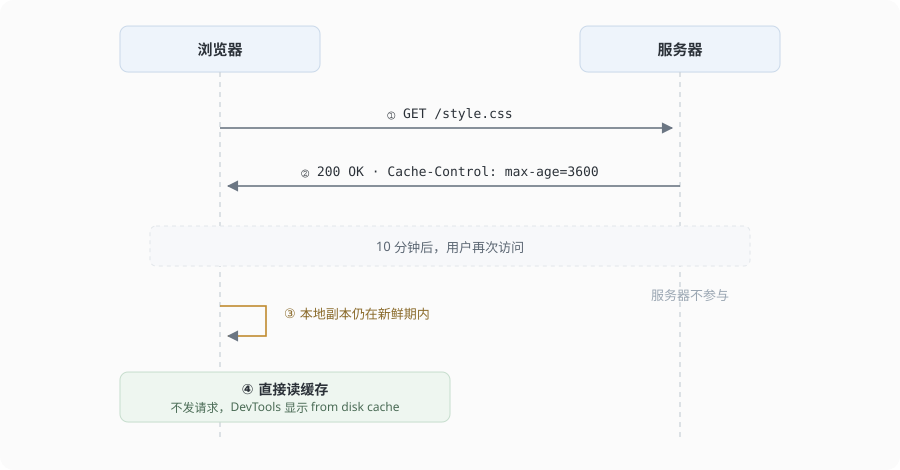
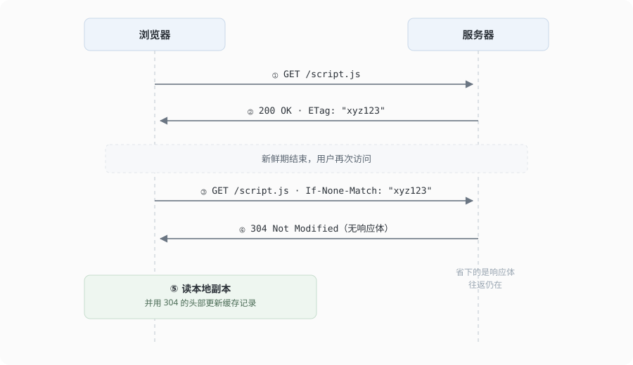
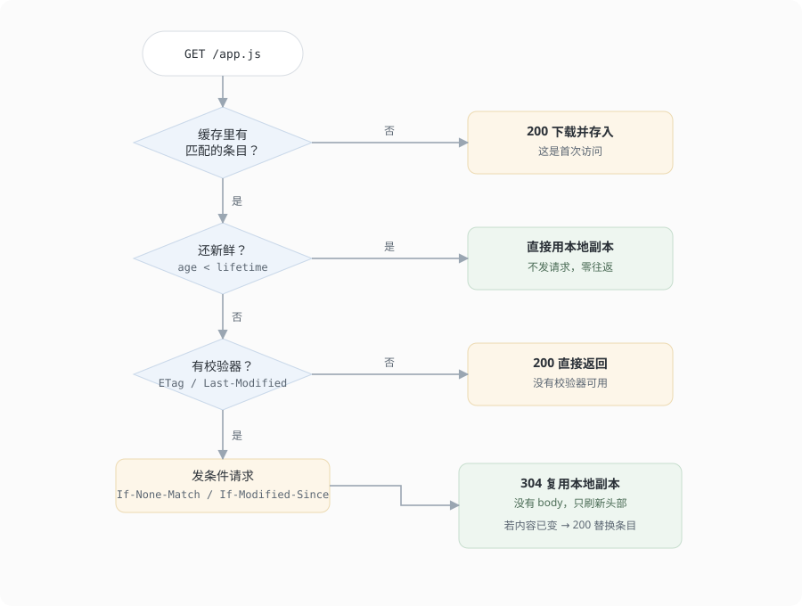

浏览器发起请求时，缓存查找的顺序大致是：

1. 先看 **Memory Cache**（内存缓存），速度快，页面关闭就失效，一般存当前页面的图片、小脚本
2. 再看 **Disk Cache**（磁盘缓存），慢一些但持久，大文件基本都落在这里
3. 都没有的话，检查**强缓存**是否命中
4. 强缓存失效，走**协商缓存**问服务器
5. 服务器返回 200 带新资源，并写入新的缓存

## 1. 强缓存

**定义：** 命中强缓存时，浏览器直接从本地副本读取，**不向服务器发送任何请求**。DevTools 的 Network 面板显示 `200 (from disk cache)` 或 `(from memory cache)`，耗时接近 0ms。

**触发条件：** 响应头中包含 `Expires` 或 `Cache-Control`。

| 响应头 | 描述 | 优先级 |
| :--- | :--- | :--- |
| `Expires`（HTTP/1.0） | 一个**绝对时间**，例如 `Expires: Wed, 21 Oct 2025 07:28:00 GMT` | 低 |
| `Cache-Control`（HTTP/1.1） | 相对时间，指令更全 | 高 |

**`Cache-Control` 常用指令：**

- `max-age=<seconds>`：资源被视为新鲜的秒数，例如 `max-age=31536000` 表示一年。
- `public`：允许浏览器、CDN 等任何缓存存储。
- `private`：只允许单个用户的浏览器缓存，CDN 这类共享缓存不能存。
- `no-cache`：**注意：并非不缓存**，而是每次使用前都要向服务器校验。真正不存的是下一条。
- `no-store`：浏览器和所有中间缓存**完全不存储**这份资源。
- `immutable`：在新鲜期内，即使用户刷新也不发校验请求。

**新鲜期怎么算：**

```
age      = 当前时间 - Date + Age
lifetime = max-age
```

`age < lifetime` 时直接用本地副本，不发请求。

响应的 `Date: 10:00:00`、`max-age=600`，浏览器 10:04 拿到，age 是 240 秒，还剩 360 秒。如果中间隔了一层 CDN，它返回 `Age: 300`，到手只剩 300 秒。**新鲜期从 `Date` 起算，不是从浏览器收到的那一刻**。

响应里既没有 `max-age` 也没有 `Expires`，但有 `Last-Modified` 时，浏览器会自己估一个新鲜期：取 `Date - Last-Modified` 的 10%。这是 Chrome 和 Firefox 的实现惯例，**规范只允许启发式，没有规定比例**。

**强缓存流程：**



（强缓存命中时，第二次访问没有请求，服务器那条线不参与。）

## 2. 协商缓存

**定义：** 强缓存失效后（或 `Cache-Control: no-cache`），浏览器**带着校验器发一次请求**，服务器判断资源有没有变。

- 没变：返回 `304 Not Modified`，**响应体为空**，浏览器用本地副本。
- 变了：返回 `200 OK`，带上新内容。

协商缓存也要一次网络请求，省下的是响应体的传输。一份 48KB 的 HTML，200 要把 body 传完，304 只有头部，几百字节。

**触发条件：** 响应头里有 `Last-Modified` 或 `ETag`。

**第一组：`Last-Modified` / `If-Modified-Since`**

| 头部 | 位置 | 描述 |
| :--- | :--- | :--- |
| `Last-Modified` | 响应头 | 资源最后修改时间 |
| `If-Modified-Since` | 请求头 | 带回上次的时间，问这之后有没有改 |

**缺点：**

- 精度只到秒，同一秒内改两次感知不到，可能错误返回 304。
- 时间不代表内容。文件被重新保存、拷贝、回滚，时间变了但内容没变，会触发一次多余的全量传输。

**第二组：`ETag` / `If-None-Match`**

| 头部 | 位置 | 描述 |
| :--- | :--- | :--- |
| `ETag` | 响应头 | 资源标识，通常由内容哈希或修改时间加文件大小生成 |
| `If-None-Match` | 请求头 | 带回上次的标识，问是否仍然匹配 |

**优点：** 基于内容或内容相关特征生成，比时间戳精确，能覆盖 `Last-Modified` 的两个缺点。

`ETag` 有两种：`"v1"` 是强校验，要求字节一致；`W/"v1"` 是弱校验，只要求语义等价。`If-None-Match` 用**弱比较**，所以 `W/"v1"` 也能换到 304，此时字节可能不同。

**优先级：** 两个校验器都带时，服务器**只认 `If-None-Match`**，`If-Modified-Since` 被忽略。

**收到 304 之后：** 浏览器用本地副本渲染，并用 304 的响应头更新已存记录，包括新的 `Date`，新鲜期重新起算。

**协商缓存流程：**



（协商缓存命中时仍有往返，省下的是响应体。）

## 3. 缓存键与可见范围

缓存按 **key** 存，key 默认是 URL。同一个地址有两种内容时，靠 `Vary` 分开。

| 头部 | 作用 |
| :--- | :--- |
| `Vary: Accept-Encoding` | 按 `Accept-Encoding` 的值分别存一份，压缩版和未压缩版互不复用 |
| `Vary: *` | 任何请求都不复用，等于放弃缓存 |

漏写 `Vary` 的后果很直接：服务器给 A 返回了 br 压缩的内容，缓存可能转给不支持 br 的客户端，页面乱码。

谁能存这份副本，是另一组指令：

| 指令 | 作用范围 |
| :--- | :--- |
| `public` | 浏览器 + CDN + 代理都能存 |
| `private` | 只有浏览器能存 |
| `s-maxage` | 只对 CDN / 代理生效，优先于 `max-age`，并隐含 `proxy-revalidate` |

`s-maxage` **管不到浏览器自己那份**。想让两端时长不一样时才需要它。

有一个常见疑问：经过 CDN 的响应，浏览器看到的 `max-age` 好像变短了。原因是 `Age` 已经有值，新鲜期被扣掉了一段。

## 4. 决策流程

一次请求会走到三条路之一。



| 结局 | 请求 | 状态码 | 代价 |
| :--- | :--- | :--- | :--- |
| 本地没有副本 | 发出 | `200` | 一次往返 + 完整 body |
| 副本新鲜 | **不发** | `200`（浏览器合成） | 零往返 |
| 副本过期 | 发出条件请求 | `304` 或 `200` | 一次往返，通常无 body |

## 5. 最佳实践

策略不是给整个网站定的，是给一类 URL 定的。

| 资源 | 例子 | 策略 | 原因 |
| :--- | :--- | :--- | :--- |
| HTML 入口 | `/index.html` | `Cache-Control: no-cache` | 每次校验，保证能拿到新的资源引用 |
| 带哈希的静态资源 | `/assets/app.a1b2c3.js` | `Cache-Control: public, max-age=31536000, immutable` | 内容变则文件名变，旧文件可长期命中缓存 |
| 接口数据 | `/api/posts` | `no-store` 或很短的 `max-age` | 时效性强，策略必须显式声明 |

```http
HTTP/1.1 200 OK
Cache-Control: public, max-age=31536000, immutable
ETag: "a1b2c3"
Vary: Accept-Encoding
Content-Encoding: br
```

一年有效期敢这么给，前提是文件名里带内容指纹。内容一变文件名就变，旧的这份永远不会被覆盖。

HTML 用 `no-cache` 而不是 `no-store`，因为前者还能走条件请求，没变只传头部；后者每次都要重新下载。为什么不给 HTML 也加一年：HTML 是唯一能把新版本推给用户的入口，它被长期缓存，用户会一直打开旧页面，而旧页面引用的接口可能已经改过结构。

接口这一类容易被漏掉。不少接口没有显式 `Cache-Control`，GET 响应又带 `Last-Modified`，浏览器可能按启发式规则存一份，造成「数据改了、刷新没变」。

## 6. 常见误区

- **`no-cache` 表示不缓存。** 它可以存，只是每次复用前必须校验。不存的是 `no-store`。
- **`immutable` 是永久缓存。** 它不延长新鲜期，只省掉新鲜期内那一次条件请求。过期后照常校验。
- **`max-age=3600` 就是一小时后过期。** 时间从 `Date` 起算，经共享缓存还要加 `Age`，到手可能只剩几分钟。
- **返回 304 说明内容没变。** 只能说校验器没变。弱校验下语义等价就回 304，字节仍可能不同。
