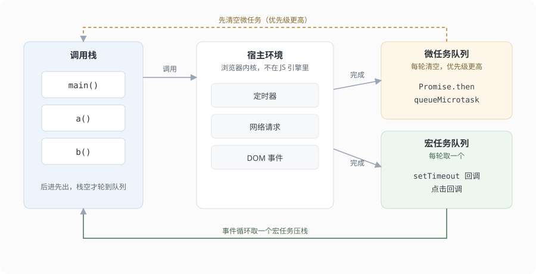
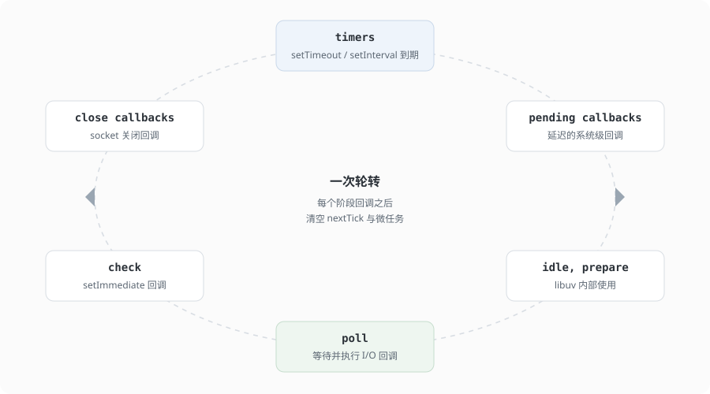

JavaScript 是单线程的。所谓单线程，是指同一时刻只有一段代码在跑——调用栈不为空时，其他事情都得等。异步能力来自宿主环境：定时器、网络、DOM 事件由浏览器（或 Node）负责，完成后把回调排进任务队列；调用栈一空，事件循环就来取。

浏览器的任务队列分两层：宏任务（`setTimeout`、事件回调，以及**整段 `<script>` 的执行**）和微任务（`Promise.then`、`queueMicrotask`）。每执行完一个宏任务，微任务队列会被一口气清空（过程中新产生的微任务也一并执行），之后才轮到渲染或下一个宏任务。

理解这套顺序，很多「看起来奇怪」的输出就有了解释：`setTimeout(fn, 0)` 为什么不立刻执行、`Promise.then` 为什么总排在定时器前面、`await` 之后的代码为什么变成了异步。

## 单线程与调用栈

引擎里有一个调用栈，函数调用压栈，返回弹栈。栈空之前，不会去处理任何排队的事件。

```js
function a() {
  b()
  console.log('a 结束')
}
function b() {
  console.log('b')
}
a()
// b
// a 结束
```

栈是后进先出，`b` 先执行完出栈，`a` 才继续。同步代码全部跑完、栈清空，事件循环才有机会取下一个任务。

`setTimeout`、网络请求、DOM 事件这些能力不在 JS 引擎里，而在宿主环境里。调用它们时，引擎只是把回调交给宿主，然后继续往下执行；等条件满足（时间到了、响应回来了），宿主再把回调放进任务队列。



（图中把宏任务画成一个队列；实际按任务来源分成多组，见下文。）

## 任务队列的两层

队列不止一个，至少分两层。

| 类型 | 常见来源 |
|---|---|
| 宏任务（task） | `setTimeout`、`setInterval`、DOM 事件、`<script>` 整体执行、I/O |
| 微任务（microtask） | `Promise.then/catch/finally`、`queueMicrotask`、`MutationObserver` |

规则的关键在两条：

1. **每执行完一个宏任务，就把微任务队列清空**，清空过程中新产生的微任务也会一并执行。
2. **微任务清空之后，才可能进入渲染**（浏览器），然后取下一个宏任务。

所以微任务的优先级比宏任务高，且会「插队」到当前宏任务结束之后、下一个宏任务之前。

```js
console.log('1')

setTimeout(() => console.log('2'), 0)

Promise.resolve().then(() => console.log('3'))

console.log('4')
// 1 4 3 2
```

`1`、`4` 是同步代码；栈空后先清微任务（`3`），再取宏任务（`2`）。

### 「宏任务」是社区叫法

HTML 规范里没有 `macrotask` 这个词，只有 task。「宏任务」是为了和「微任务」对称而造出来的说法，规范中的对应物叫 task queue。

而且它不是一个队列。规范定义了**多个任务队列**，按任务来源（task source）划分：定时器一个、用户交互一个、网络响应一个、DOM 操作一个。事件循环每次从哪个队列取任务，规范没有写死，由浏览器按优先级决定——实践中用户输入通常优先于定时器，所以点击回调可能插到几个已经到期的定时器前面。

微任务那边只有一个队列，取空为止；宏任务这边是一组队列，各自内部先进先出。本文为了叙述方便，图上把宏任务画成一个队列，说到顺序时指的是同一来源队列内部。

## 一轮循环的顺序

把规则串起来，浏览器里的一轮是：

1. 取出一个宏任务，执行到栈空
2. 清空微任务队列（包括执行中新增的）
3. 需要的话进行渲染：样式计算、布局、绘制
4. 回到第 1 步

渲染不是每轮都做。浏览器按屏幕刷新率（通常 60Hz，约 16.7ms）决定是否渲染，中间可能连续执行多个宏任务。这也是为什么在微任务里死循环会卡死页面：微任务不清空，渲染永远轮不到。

## Node 的六个阶段

Node 的事件循环由 libuv 驱动，不是一个队列，而是按阶段轮转。每个阶段维护自己的回调队列，走完一圈再回到起点：



| 阶段 | 处理什么 |
|---|---|
| timers（定时器） | `setTimeout`、`setInterval` 到期回调 |
| pending callbacks（待处理回调） | 上一轮延迟的系统级回调（如 TCP 错误） |
| idle, prepare（空闲与准备） | libuv 内部使用 |
| poll（轮询） | 等待并执行 I/O 回调，大多数业务代码在这里 |
| check（检查） | `setImmediate` 的回调 |
| close callbacks（关闭回调） | `socket.on('close')` 这类关闭回调 |

两个容易混淆的点：

**`process.nextTick` 不属于任何阶段。** 它在当前操作结束后立刻执行，比 Promise 微任务还早：

```js
Promise.resolve().then(() => console.log('promise'))
process.nextTick(() => console.log('nextTick'))
// nextTick
// promise
```

**`setTimeout(fn, 0)` 和 `setImmediate` 的顺序不固定。** 在主模块里，两者谁先取决于进程启动耗时是否超过 1ms；在 I/O 回调内部，`setImmediate` 一定先执行，因为 poll 阶段结束后紧接着就是 check 阶段。

```js
const fs = require('node:fs')

fs.readFile(__filename, () => {
  setTimeout(() => console.log('timeout'), 0)
  setImmediate(() => console.log('immediate'))
})
// immediate
// timeout
```

阶段顺序带来两个实际后果：

**定时器可能比预期晚。** `poll` 阶段有源源不断的 I/O 回调时，这一轮会一直停在 poll，timers 要等下一轮才轮得到。所以「设了 100ms 的定时器，结果 300ms 才执行」，未必是定时器不准，而是前面有活没干完。

**空闲时进程不耗 CPU。** 没有事件时，poll 会阻塞等待，直到有新事件或最近的定时器到期，而不是空转轮询。

## 两种运行时的差异

| 维度 | 浏览器 | Node |
|---|---|---|
| 调度者 | 浏览器内核 | libuv |
| 队列结构 | 宏任务队列 + 微任务队列 | 六个阶段，各自有队列 |
| 微任务时机 | 每个宏任务之后 | 每个阶段回调之后、阶段切换时 |
| 特有的高优先级队列 | 无 | `process.nextTick` |
| 渲染 | 每轮可能渲染一次 | 无渲染概念 |

共同点更重要：**同步代码优先、微任务先于宏任务、微任务会一次性清空**。这三条在两边都成立。

## 常见误判

**`setTimeout(fn, 0)` 不是 0 毫秒。** 规范规定嵌套超过 5 层后最小延迟 4ms，浏览器也会做节流；它只表示「尽快排到宏任务队列」，不保证立即执行。

**`await` 后面的代码是微任务。** `await` 相当于把后续代码包进 `then`，所以它会让出当前执行，但不阻塞其他任务。

**CPU 密集的计算放哪都会卡。** 事件循环是单线程调度，不管放在宏任务还是微任务里，都会占住线程。真要避免阻塞，只能拆片（`setTimeout` 分步）或交给 Worker。

## 小结

- 栈清空才轮到队列；栈空后先清微任务，再取宏任务。
- 微任务优先级更高，且一次清空，之后才是渲染。
- Node 按六个阶段轮转，`nextTick` 比 Promise 更早，`setImmediate` 在 check 阶段。
- 规范里只有 task，「宏任务」是社区叫法，且按来源分成多个队列。
